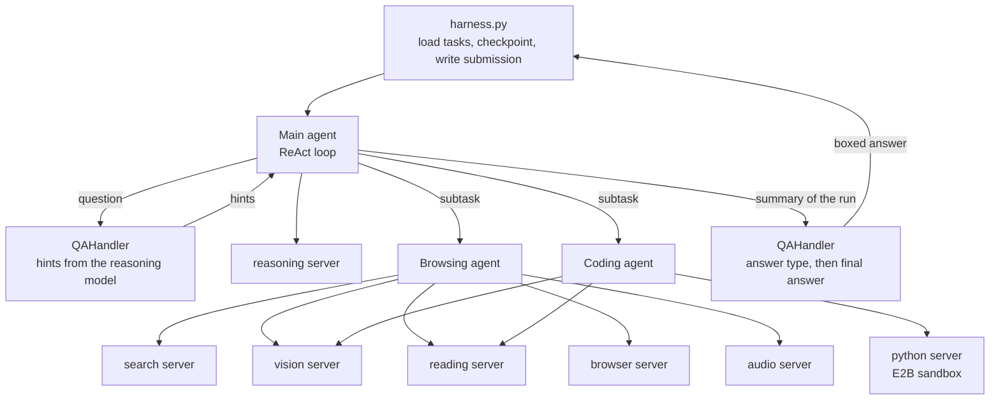

# sukuna-agent-benchmarks

The benchmark agents Midsphere AI built to test Sukuna, its general-purpose agent, on GAIA and on the IMO 2025 problems. Sukuna reached 70.76% on the GAIA test set. This repository holds the agents, the harness, the tool servers and every result file, from July 2025 to June 2026.

Midsphere AI wound down in 2026. The code is published as it was, with secrets and datasets removed. It is not maintained.

## Results

| Benchmark | Result | Models | Date | Graded by | Evidence |
|---|---|---|---|---|---|
| GAIA, test split (301 tasks) | 70.76% (213/301). Level 1: 79/93. Level 2: 108/159. Level 3: 26/49. | gpt-5, gemini-2.5-pro, o3, claude-sonnet-4, as declared on the leaderboard | 2025-10-10 | The GAIA leaderboard. Test answers are private. | [leaderboard_rows.json](results/gaia/test/leaderboard_rows.json), [submissions/](results/gaia/test/submissions) |
| GAIA, validation split (165 tasks) | 84.85% (140/165), best of five passes. The first full pass scored 120/165 (72.73%). | Not recorded per task | 2025-08-09 to 2025-09-26 | Ourselves, with the leaderboard's scorer | [answers.jsonl](results/gaia/validation/answers.jsonl), [summary.json](results/gaia/validation/summary.json), [score_validation.py](results/gaia/score_validation.py) |
| IMO 2025 (6 problems) | The solver declared a complete solution on 5 of 6 (problems 1 to 5). No human graded the proofs. | gemini-2.5-pro as solver and as grader | 2025-08-13 | Not independently graded | [solutions.json](results/imo-2025/solutions.json), [logs/](results/imo-2025/logs) |

What these numbers mean, in plain terms:

- **GAIA test.** The 70.76% is the tenth of ten leaderboard entries made between 2025-10-01 and 2025-10-15. The first entry scored 51.83%. Between entries we re-ran subsets of tasks, sometimes with a different model, and merged the answers into the next submission. The score is the result of that iteration against the leaderboard. It is not a single run of one model. The ten rows are public in the `gaia-benchmark/results_public` dataset under the organisation "Midsphere AI", models "Sukuna V0.1" to "Sukuna V0.1.9".
- **GAIA validation.** Validation answers are public, so we scored locally. After each pass we re-ran only the tasks that were wrong. A best-of-five number like this is higher than what one run gives. The file recorded 141 correct at the time. Rescored against the dataset copy we had, it is 140, because one gold answer differs.
- **IMO 2025.** The solver wrote "I have successfully solved the problem" for problems 1 to 5 and reported only an upper bound for problem 6. The final answers to problems 1, 3, 4 and 5 match the official answers. Problem 2 is a proof with no numeric answer. Nobody checked the proofs line by line. The run log shows several attempts per problem (7 for problem 1, 2 for problem 2, 1 for problem 3, 5 for problem 4, 4 for problem 5, 17 for problem 6). The stored record has no grader review for problems 1 to 3, and the last stored grader review for problems 4 and 5 still lists a justification gap.

[results/README.md](results/README.md) describes every file.

## Two generations of the GAIA agent

The 2025 results above came from the first GAIA agent. It ran on the Midsphere runtime. That code was removed from this repository in March 2026 and is not included here.

The code in `gaia/` is the second agent, written in March 2026 on [Exo](https://github.com/midsphere-ai/exo), our own agent framework, which was called Orbiter at the time. It was run on single validation tasks during development. It has no full benchmark run. The only output kept from it is [seven attempts at one level 3 task](results/gaia/validation/exo_agent_single_task_2026-03.jsonl).

## Layout

```
gaia/      GAIA agent on Exo: harness, agents, LLM providers, MCP tool servers
imo/       IMO solver: a solver agent and a grader agent in a loop
results/   Result files for GAIA and IMO 2025, and a scorer for GAIA validation
```

## How the GAIA agent works



One task goes through these steps:

1. `gaia/harness.py` reads `metadata.jsonl` for the chosen split and skips tasks already in the checkpoint file.
2. It builds three `ReActAgent` instances (`gaia/agent/react_agent.py`): a main agent, a browsing agent and a coding agent. Each tool server is started as an MCP subprocess from a separate Python environment and its tools are wrapped as Exo `FunctionTool` objects.
3. The main agent only has the reasoning tool and the two sub-agents. A sub-agent appears to the main agent as a tool that takes a `subtask` string (`gaia/agent/tool_call_handler.py`).
4. Before the loop starts, `QAHandler` (`gaia/agent/qa_handler.py`) asks a reasoning model for notes on parts of the question that are easy to misread. The notes are added to the task prompt.
5. The loop calls the model, runs at most one tool call per turn, and stops after 20 iterations or when the model stops calling tools. `ContextManager` keeps the history and writes a summary at the end. If the context limit is hit, the loop stops and summarises what it has.
6. `QAHandler` classifies the expected answer type, then asks the reasoning model for the final answer from the summary. The harness takes the `\boxed{}` value.
7. The harness appends one JSON line to the checkpoint and calls `fsync`, so a crash loses at most the task in progress. The harness scores validation tasks with a lowercase exact match. The scorer in `results/gaia/score_validation.py` is the leaderboard's and is more lenient on numbers and lists.

Other parts:

- `gaia/harness_tui.py` is a Textual dashboard for the same run loop, with pause, skip and a live log.
- `gaia/llm/` holds the model providers. `openrouter_llm.py` talks to any OpenAI-compatible endpoint, adds Anthropic cache-control markers, estimates tokens with tiktoken, and routes one model family through the Responses API. `vertex_llm.py` adds Google OAuth2 token refresh. `mirothinker_llm.py` converts tool schemas to the XML tool-call format the MiroThinker models were trained on and parses the calls back out.
- `gaia/agent/plan_tracker.py` extracts a numbered plan from model output, tracks step status and writes `todo.md`. It is switched off in the harness configuration.
- `gaia/agent/swarm_factory.py` builds the same agents as native Exo `Agent` and `Swarm` objects. The harness does not use it.
- `gaia/tool/mcp_servers/doubter.py` is a review tool that scores an action history for flaws. It is not wired into the harness.
- `gaia/check_tool_servers.py` calls each tool server function directly and prints pass or fail.

Tool servers in `gaia/tool/mcp_servers/`:

| Server | What it does | Needs |
|---|---|---|
| `reasoning_mcp_server.py` | Sends a hard sub-question to a reasoning model | `GRADIENT_API_KEY` |
| `searching_mcp_server.py` | `general_search`: currently calls Jina DeepSearch. Functions for Perplexica and Serper are in the file but not in the engine list. | `JINA_API_KEY` |
| `reading_mcp_server.py` | Converts a file or URL to text with markitdown. Web pages go through the Jina reader. | `JINA_API_KEY` for web pages |
| `vision_mcp_server.py` | Answers questions about an image. Analyses YouTube video with Gemini. | `GRADIENT_API_KEY`, `GEMINI_API_KEY` |
| `audio_mcp_server.py` | Transcribes audio and answers questions about it | `OPENROUTER_API_KEY` |
| `python_server.py` | Runs commands and Python in an E2B sandbox, moves files in and out | `E2B_API_KEY` |
| `browser_use_mcp_server.py`, `auto_browser.py` | Drives Chrome with browser-use. The controller in `gaia/tool/browser/` adds actions for PDFs, YouTube frames, Google Maps and Street View. | Chrome, `GRADIENT_API_KEY` |

## How the IMO solver works

`imo/run.py` runs two agents on one problem from `imo/problems.jsonl`:

1. The solver gets the problem and the system prompt in `imo/prompt.py`. It must return a verdict, a method sketch and a full proof.
2. The grader (`imo/grader.py`) reviews the solution step by step. It classifies each issue as a critical error or a justification gap. It does not fix anything.
3. The solver gets the problem again with every earlier solution and review, and writes a new solution.
4. The loop stops when the solver claims a complete solution after at least two reviews, when the grader's review contains one of four acceptance phrases, or after 10 rounds.

Know the limits of this design. The stop condition is the solver's own claim. In the August 2025 run the grader was the same model as the solver. The logs of that run show problems 1 to 3 stopping on the solver's first claim, before any review, so the stop rule was looser when those were run.

## Setup

### GAIA

You need Python 3.12, [uv](https://docs.astral.sh/uv/), Node.js, and Chrome or Chromium.

The agent and the tool servers use two environments, because the tool servers pin about 240 packages.

```bash
cd gaia

# 1. agent environment
uv sync

# 2. tool environment (use requirements_mac.txt on macOS)
uv venv tool/.venv-tool --python 3.12
uv pip install --no-deps -r tool/requirements.txt --python tool/.venv-tool/bin/python
tool/.venv-tool/bin/python -m playwright install

# 3. configuration
cp .env.example .env
```

`tool/requirements.txt` was exported on Windows and lists `pywin32` and `pyreadline3`. Remove those two lines on Linux. `requirements_mac.txt` still lists `pyreadline3`.

`pyproject.toml` pins Exo at commit `7922eb2` on the branch `ralph/agent-core-feature-port`, from when its packages were named `orbiter-*`. If that commit is not in the published Exo repository, `uv sync` will fail and the `orbiter.*` imports need to be changed to the current Exo package names.

`docker-compose.yml` starts a local SearXNG instance on port 8888. The Perplexica search package uses it.

Run:

```bash
cd gaia
uv run python harness.py --split validation --level 1 --limit 5
uv run python harness.py --split validation --no-resume
uv run python harness.py --split test --checkpoint runs/my_checkpoint.jsonl
uv run python harness_tui.py
tool/.venv-tool/bin/python check_tool_servers.py
```

Output goes to `gaia/runs/`: a checkpoint file per split and a timestamped submission file.

### IMO

```bash
cd imo
pip install -r requirements.txt
cp .env.example .env
python run.py --q imo4
```

The problem ids are `imo1` to `imo6`, and `test` for a one-line check. Logs and `results.json` go to `imo/output/`.

The August 2025 run used the Midsphere runtime. The imports now point at upstream `aworld` and have not been run since that change.

## Datasets

**GAIA is not in this repository.** Its authors ask that it is not reshared, so the questions, the attached files and the answers were removed. Request access at <https://huggingface.co/datasets/gaia-benchmark/GAIA>, then:

```bash
huggingface-cli download gaia-benchmark/GAIA --repo-type dataset --local-dir data/gaia
```

The harness expects `data/gaia/2023/validation/metadata.jsonl` and `data/gaia/2023/test/metadata.jsonl` at the repository root, with the attached files next to them. Set `GAIA_DATASET_DIR` to use another location.

The result files here hold task ids and model answers only. A few answers are long because the agent returned its working notes when it failed to produce a short answer.

The six IMO 2025 problems are public and are in `imo/problems.jsonl`.

## Environment variables

For `gaia/.env`:

| Variable | Used by | Purpose |
|---|---|---|
| `API_KEY`, `API_BASE`, `MODEL_NAME` | harness | Main model for all three agents |
| `MODEL_PROVIDER` | harness | `openrouter` (any OpenAI-compatible endpoint), `vertex` or `azure` |
| `OPENAI_API_KEY`, `REASONING_MODEL_NAME`, `REASONING_BASE_URL` | QAHandler | Model for hints and final answer extraction |
| `GRADIENT_API_KEY`, `GRADIENT_BASE_URL` | reasoning, vision, search, browser servers | OpenAI-compatible endpoint for the tool servers' own model calls |
| `OPENROUTER_API_KEY`, `OPENROUTER_BASE_URL` | audio server | Audio models |
| `GEMINI_API_KEY` | vision server | YouTube analysis |
| `E2B_API_KEY`, `E2B_TEMPLATE_ID` | python server | Sandbox |
| `JINA_API_KEY`, `SERPER_API_KEY`, `SEARXNG_URL`, `PERPLEXICA_MODEL`, `PERPLEXICA_FAST_MODEL` | search server | Search engines |
| `CHROME_PATH`, `CHROME_USER_PROFILE_DIR` | browser server | Browser binary and profile |
| `GOOGLE_SERVICE_ACCOUNT_B64` or `GOOGLE_APPLICATION_CREDENTIALS` | `vertex_llm.py` | Vertex AI credentials |
| `GAIA_DATASET_DIR` | harness | Path to the GAIA `2023/` folder |
| `AUTO_BROWSER_TRANSPORT`, `AUTO_BROWSER_SSE_URL`, `AUTO_BROWSER_START_SSE` | harness | Browser server transport. Default is SSE on `127.0.0.1:8930`, started by the harness. |

For `imo/.env`:

| Variable | Purpose |
|---|---|
| `LLM_MODEL_NAME`, `LLM_API_KEY`, `LLM_BASE_URL` | Solver model |
| `IMO_LLM_MODEL_NAME`, `IMO_LLM_API_KEY`, `IMO_LLM_BASE_URL` | Grader model |
| `IMO_OUTPUT_DIR` | Where logs and results are written |

## Thanks

Thanks to AWorld, DeepAgent, MiroFlow, smolagents, browser-use, MiroThinker, CAMEL and the GAIA team.

## Timeline

- 2025-07: first GAIA validation runs.
- 2025-08-09: first full validation pass, 120/165.
- 2025-08-13: IMO 2025 run.
- 2025-09-26: validation at 141/165 as recorded, after five passes. First test split run.
- 2025-10-01 to 2025-10-15: ten GAIA test leaderboard entries, 51.83% to 70.76%.
- 2026-03: GAIA agent rewritten on Exo. The first agent's code was removed.
- 2026-06: last change.
- 2026: Midsphere AI wound down.

## Licence

[MIT](LICENSE). Free to use, change, self-host and build on, including commercially. See [NOTICE.md](NOTICE.md) for third-party notices.
